# Schnittstelle Controller -> View

Entwurf vom 05.11.2026 zur Abstimmung mit Karin (View) und Mohammad (Model).
Owner: Maikel (Controller). Maßgeblich wird nach der Umsetzung `src/controller/index.ts`.

Dieses Dokument legt fest, was die View aus `@controller` importieren kann. Was dafür im
Datenmodell noch fehlt, steht in den [Anforderungen an das Model](model-anforderungen.md).

Kontext: Die App organisiert Spieltermine von D&D-Gruppen. Eine Person kann beliebig vielen
Gruppen angehören und beliebig viele Termine haben, auch gleichzeitig. Überschneidungen werden
nur gewarnt.

## Inhalt

| Bereich                                  | Story   | Abschnitt                                              |
| ---------------------------------------- | ------- | ------------------------------------------------------ |
| Registrierung und Anmeldung              | -       | [Konto](#konto-useauth)                                |
| Gruppen, Gruppenleitung, Mitglieder      | -       | [Gruppen](#gruppen-und-gruppenleitung)                 |
| Einladungscode teilen und beitreten      | -       | [Einladungen](#einladungen)                            |
| Orte                                     | -       | [Orte](#orte)                                          |
| Nächste Termine, Hinweise                | 1, 7    | [Übersicht](#übersicht-story-1-useupcomingoverview)    |
| Terminkalender, anlegen, ändern, absagen | -       | [Kalender](#terminkalender)                            |
| Überschneidungswarnung                   | E1      | [Überschneidungen](#überschneidungen-e1)               |
| Gastgeber-Rotation, Vertretung, Tausch   | 2       | [Gastgeber](#gastgeber-rotation-story-2)               |
| Ablauf eines Termins                     | 3 bis 9 | [Zeitfenster](#ablauf-eines-termins)                   |
| Vorschläge und Abstimmung                | 3, 4    | [Vorschläge](#vorschläge-und-abstimmung-story-3-und-4) |
| Bewertung                                | 5       | [Bewertung](#bewertung-story-5)                        |
| Verspätung melden                        | 6       | [Verspätung](#verspätung-melden-story-6)               |
| Essensrichtung, Lieferdienst, Bestellung | 7, 8, 9 | [Essen](#essen-story-7-bis-9)                          |
| Statistik der Spielorte                  | E2      | [Statistik](#statistik-der-spielorte-e2)               |

Push-Benachrichtigungen sind bewusst nicht enthalten. Erinnerungen erscheinen als Hinweise in
der App (siehe [Übersicht](#übersicht-story-1-useupcomingoverview)).

## Grundsätze

1. **Die View sieht nur `@controller`.** Alle Typen, die die View braucht, exportiert der
   Controller selbst. Datenbanktypen aus `@model` werden nie durchgereicht.
2. **Hooks zum Lesen, Funktionen zum Ändern.** Lesende Daten kommen über React-Hooks
   (`useMyGroups`, `useCalendar`, ...). Änderungen sind `async`-Funktionen (`createGroup`,
   `cancelSession`, ...). Beides ist eine dünne Hülle um reine, getestete Funktionen.
3. **Einheitlicher Ladezustand.** Jeder lesende Hook liefert `LoadState<T>` mit `loading`,
   `ready` oder `error` und eine Funktion `reload()`.
4. **Änderungen werfen nicht.** Jede ändernde Funktion liefert `ActionResult<T>`, also entweder
   `{ ok: true, data }` oder `{ ok: false, error }`.
5. **Automatisch aktuell.** Nach einer erfolgreichen Änderung laden betroffene Hooks von selbst
   neu. Änderungen anderer Personen erscheinen nach `reload()` oder beim nächsten Öffnen.
6. **Rechte kommen mit den Daten.** Hooks liefern Felder wie `canEdit`, damit die View Buttons
   vorher ausblenden kann. Der Controller prüft die Rechte trotzdem bei jeder Änderung.
7. **Fehler als Codes, Texte in der View.** Der Controller liefert einen `ControllerError` mit
   festem `code`. Die View formuliert daraus den deutschen UI-Text.
8. **Zeiten als `Date`.** Formatierung macht die View, z. B. mit `Intl.DateTimeFormat('de-DE')`.
   Kalendertage richten sich nach der Zeitzone des Geräts.
9. **Warnen statt verbieten.** Überschneidende Termine sind immer erlaubt.

## Überblick

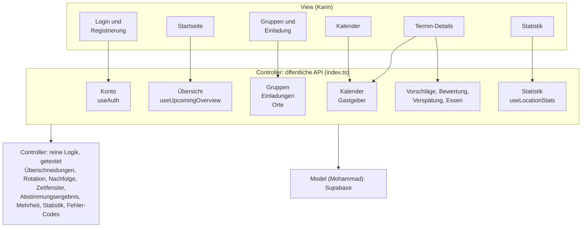

## Gemeinsame Typen

```ts
/** Ergebnis jedes lesenden Hooks. */
export type LoadState<T> =
  | { status: 'loading' }
  | { status: 'ready'; data: T }
  | { status: 'error'; error: ControllerError };

/** Lesende Hooks liefern zusätzlich reload(). */
export type Loadable<T> = LoadState<T> & { reload(): void };

/** Ergebnis jeder ändernden Funktion. Wirft nie. */
export type ActionResult<T> = { ok: true; data: T } | { ok: false; error: ControllerError };

export type ControllerErrorCode =
  // Konto
  | 'invalid-credentials' // E-Mail oder Passwort falsch
  | 'username-taken' // Benutzername vergeben
  | 'email-taken' // E-Mail bereits registriert
  | 'weak-password' // Passwort zu kurz
  // Rechte
  | 'not-signed-in' // Aktion braucht Anmeldung
  | 'forbidden' // kein Zugriff, z. B. keine Mitgliedschaft
  | 'not-group-admin' // nur die Gruppenleitung darf das
  // Einladungen
  | 'invite-invalid' // Code unbekannt
  | 'invite-expired' // Code abgelaufen oder ersetzt
  | 'join-blocked' // aus der Gruppe entfernt, Beitritt nicht freigegeben
  // Termine
  | 'session-cancelled' // Termin ist abgesagt
  | 'window-closed' // Zeitfenster vorbei oder noch nicht offen
  // Allgemein
  | 'invalid-input' // Eingabe unvollständig oder ungültig
  | 'not-found' // Datensatz existiert nicht (mehr)
  | 'network' // keine Verbindung
  | 'unknown';

export interface ControllerError {
  code: ControllerErrorCode;
  field?: string; // bei 'invalid-input': betroffenes Eingabefeld, z. B. 'username'
}

export type GroupRole = 'admin' | 'member';

export interface UserRef {
  userId: string;
  username: string;
}
```

Vorschlag für UI-Texte (Entscheidung der View):

| `code`                | Beispieltext                                                     |
| --------------------- | ---------------------------------------------------------------- |
| `invalid-credentials` | "E-Mail oder Passwort ist falsch."                               |
| `username-taken`      | "Dieser Benutzername ist schon vergeben."                        |
| `email-taken`         | "Mit dieser E-Mail gibt es schon ein Konto."                     |
| `weak-password`       | "Das Passwort braucht mindestens 8 Zeichen."                     |
| `not-signed-in`       | "Bitte melde dich an."                                           |
| `forbidden`           | "Dafür fehlt dir die Berechtigung."                              |
| `not-group-admin`     | "Das kann nur die Gruppenleitung."                               |
| `invite-invalid`      | "Diesen Einladungscode gibt es nicht."                           |
| `invite-expired`      | "Die Einladung ist abgelaufen. Bitte frag nach einer neuen."     |
| `join-blocked`        | "Du kannst dieser Gruppe gerade nicht beitreten."                |
| `session-cancelled`   | "Dieser Termin wurde abgesagt."                                  |
| `window-closed`       | "Das ist gerade nicht möglich, das Zeitfenster ist geschlossen." |
| `invalid-input`       | "Bitte prüfe deine Eingabe."                                     |
| `not-found`           | "Das gibt es nicht mehr."                                        |
| `network`             | "Keine Verbindung. Bitte versuche es erneut."                    |
| `unknown`             | "Etwas ist schiefgelaufen. Bitte erneut laden."                  |

## Konto: `useAuth()`

```ts
export type AuthStatus = 'checking' | 'signed-out' | 'signed-in';

export interface CurrentUser {
  id: string;
  username: string;
  email: string;
}

export interface SignUpInput {
  username: string;
  email: string;
  password: string;
}

export interface SignUpResult {
  user: CurrentUser | null; // null, solange die E-Mail noch bestätigt werden muss
  needsEmailConfirmation: boolean;
}

export interface AuthState {
  status: AuthStatus;
  user: CurrentUser | null; // nur bei 'signed-in' gesetzt
  signUp(input: SignUpInput): Promise<ActionResult<SignUpResult>>;
  signIn(email: string, password: string): Promise<ActionResult<CurrentUser>>;
  signOut(): Promise<void>;
}

export function useAuth(): AuthState;
```

Regeln:

- **Benutzername:** 3 bis 20 Zeichen, Buchstaben, Ziffern und `_`. Eindeutig ohne Rücksicht auf
  Groß- und Kleinschreibung. Er ist der Anzeigename in Gruppen.
- **E-Mail:** gültiges Format, eindeutig. Anmelden geht mit E-Mail und Passwort.
- **Passwort:** mindestens 8 Zeichen.
- Ungültige Felder liefern `invalid-input` mit `field` (`username`, `email`, `password`).
  Die View kann dieselben Regeln schon beim Tippen anzeigen.
- Ob die E-Mail bestätigt werden muss, entscheidet die Supabase-Einstellung. Die View zeigt bei
  `needsEmailConfirmation` einen Hinweis "Bitte bestätige deine E-Mail".
- Beim App-Start ist der Status `checking`, bis feststeht, ob noch eine Anmeldung gespeichert
  ist. Der Anmeldestatus gilt app-weit, ein Provider in der View ist nicht nötig.

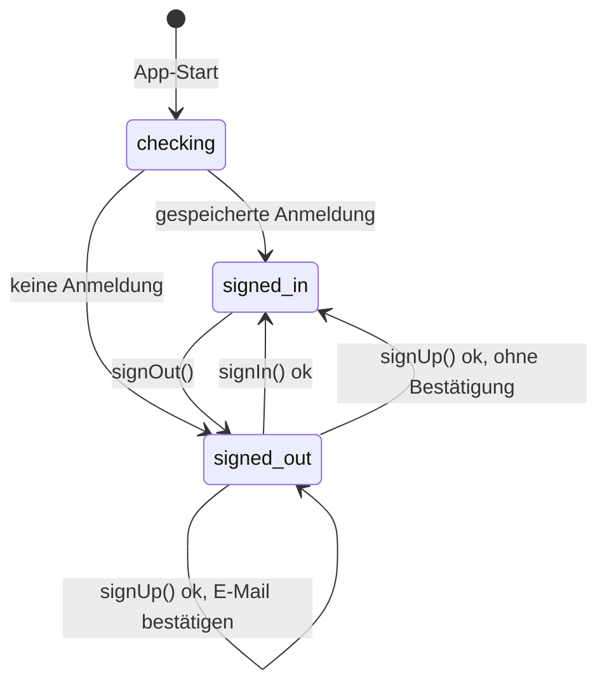

## Gruppen und Gruppenleitung

Eine Person kann beliebig vielen Gruppen angehören. Jede Gruppe hat genau eine Gruppenleitung
(Rolle `admin`). Anfangs ist das die Person, die die Gruppe anlegt.

```ts
export interface GroupSummary {
  id: string;
  name: string;
  myRole: GroupRole;
  memberCount: number;
  nextSession: SessionSummary | null;
}

export interface GroupMember extends UserRef {
  joinedAt: Date;
  role: GroupRole;
}

export interface RemovedUser extends UserRef {
  removedAt: Date;
  rejoinAllowed: boolean; // true, nachdem die Leitung den Beitritt freigegeben hat
}

export interface GroupDetails {
  id: string;
  name: string;
  myRole: GroupRole;
  canEdit: boolean; // true für die Gruppenleitung
  members: GroupMember[]; // Leitung zuerst, dann nach joinedAt
  successorIfAdminLeaves: GroupMember | null; // wer übernehmen würde
  removedUsers: RemovedUser[]; // nur für die Leitung gefüllt, sonst []
}

export interface MembershipChange {
  newAdmin: GroupMember | null; // gesetzt, wenn die Leitung gewechselt hat
  sessionsWithoutHost: SessionSummary[]; // kommende Termine, die jetzt keine Gastgeber:in haben
}

export function useMyGroups(): Loadable<GroupSummary[]>;
export function useGroup(groupId: string): Loadable<GroupDetails>;

export function createGroup(name: string): Promise<ActionResult<GroupSummary>>;
export function renameGroup(groupId: string, name: string): Promise<ActionResult<GroupSummary>>; // Leitung
export function leaveGroup(groupId: string): Promise<ActionResult<MembershipChange>>;
export function removeMember(
  groupId: string,
  userId: string,
): Promise<ActionResult<MembershipChange>>; // Leitung
export function allowRejoin(groupId: string, userId: string): Promise<ActionResult<void>>; // Leitung
```

Regeln:

- **Name:** 1 bis 50 Zeichen nach Entfernen von Leerzeichen am Rand, sonst `invalid-input`.
- **Umbenennen, Mitglieder entfernen, Beitritt freigeben:** nur die Gruppenleitung, sonst
  `not-group-admin`. Die Leitung kann sich nicht selbst entfernen, dafür gibt es `leaveGroup`.
- **Entfernte Personen** können über keinen Einladungscode wieder beitreten, bis die Leitung
  `allowRejoin` aufruft. Danach geht es mit einem gültigen Code wieder. Die Freigabe macht
  niemanden automatisch zum Mitglied.
- **Austritt der Leitung:** Es übernimmt das Mitglied mit dem frühesten Beitrittsdatum, bei
  Gleichstand die kleinere `userId`. Die View kann das vorher mit `successorIfAdminLeaves`
  anzeigen.
- **Letztes Mitglied tritt aus:** Die Gruppe wird mit allen Daten gelöscht. Die View fragt
  vorher nach (`memberCount === 1`).
- **Kommende Termine** von ausgetretenen oder entfernten Personen als Gastgeber:in bleiben
  bestehen, haben dann aber keine Gastgeber:in. Sie kommen in `sessionsWithoutHost` zurück und
  erscheinen bei der Leitung als Hinweis `assign-host`.
- Freiwillige Übergabe der Leitung per Anfrage und Zustimmung kommt später.

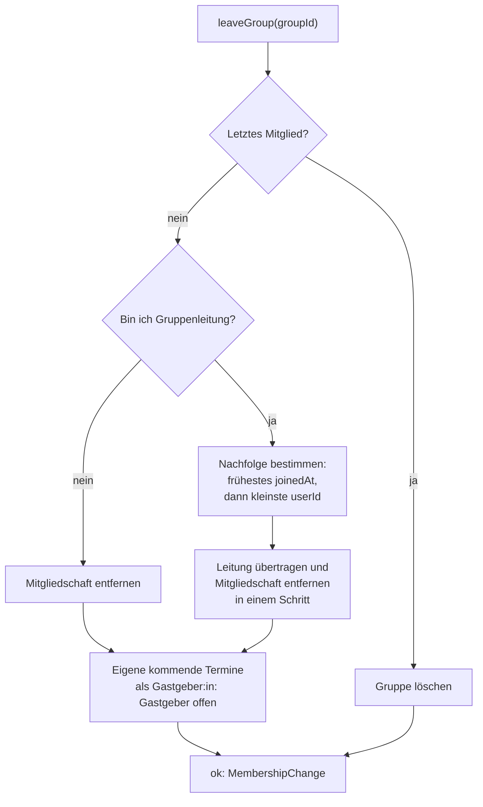

## Einladungen

Beitreten geht über einen Einladungscode, den Mitglieder z. B. per WhatsApp teilen.

```ts
export interface GroupInvite {
  code: string; // 8 Zeichen, z. B. "K7QM4XPA"
  displayCode: string; // lesbar gruppiert, z. B. "K7QM-4XPA"
  groupId: string;
  groupName: string;
  expiresAt: Date;
  createdBy: UserRef;
}

export interface InvitePreview {
  groupName: string;
  memberCount: number;
  expiresAt: Date;
  alreadyMember: boolean;
}

/** Aktuell gültiger Code der Gruppe oder null. */
export function useInvite(groupId: string): Loadable<GroupInvite | null>;

/** Gibt den gültigen Code zurück oder legt einen neuen an. Jedes Mitglied. */
export function getOrCreateInvite(groupId: string): Promise<ActionResult<GroupInvite>>;

/** Alten Code ungültig machen und neuen anlegen. Nur Leitung. */
export function renewInvite(groupId: string): Promise<ActionResult<GroupInvite>>;

/** Zeigt vor dem Beitritt, zu welcher Gruppe der Code gehört. */
export function previewInvite(code: string): Promise<ActionResult<InvitePreview>>;

export function joinGroup(code: string): Promise<ActionResult<GroupSummary>>;
```

Regeln:

- **Gültigkeit:** 7 Tage ab Erstellung. Ein Code gilt für beliebig viele Beitritte.
- **Ein Code je Gruppe:** Solange ein Code gültig ist, liefert `getOrCreateInvite` denselben.
  `renewInvite` macht den alten sofort ungültig (z. B. wenn er an die Falschen ging).
- **Eingabe:** Groß- und Kleinschreibung, Leerzeichen und `-` werden ignoriert. Der Code nutzt
  keine verwechselbaren Zeichen (kein `0`, `O`, `1`, `I`, `L`).
- **Teilen:** Die View baut den Text und ruft das Teilen-Menü des Geräts auf (`Share` aus
  React Native), z. B. "Tritt unserer D&D-Gruppe 'Die Würfelrunde' bei: Code K7QM-4XPA, gültig
  bis 12.11.". Ein direkter Link in die App ist ein offener Punkt.
- **Bereits Mitglied:** `joinGroup` liefert `ok` ohne Änderung.
- Neue Mitglieder kommen ans Ende der Gastgeberreihenfolge.

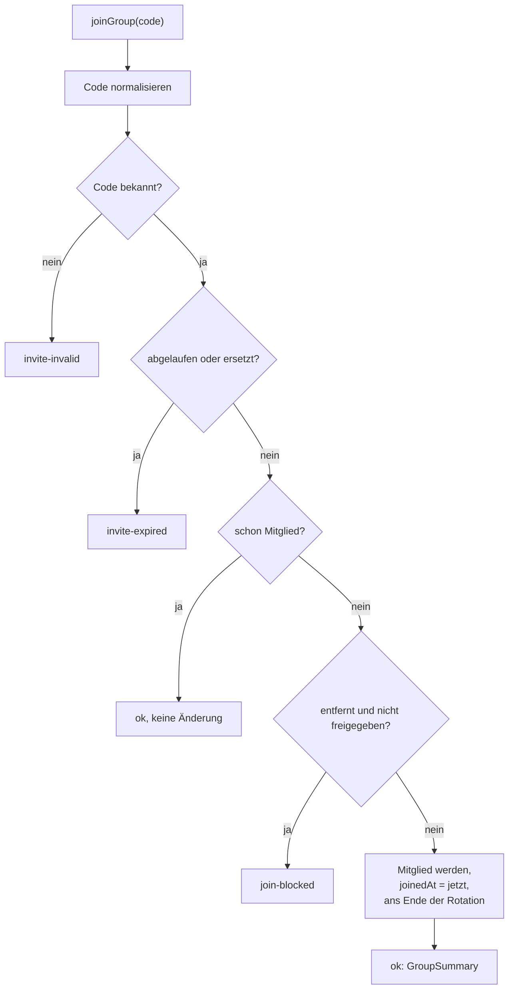

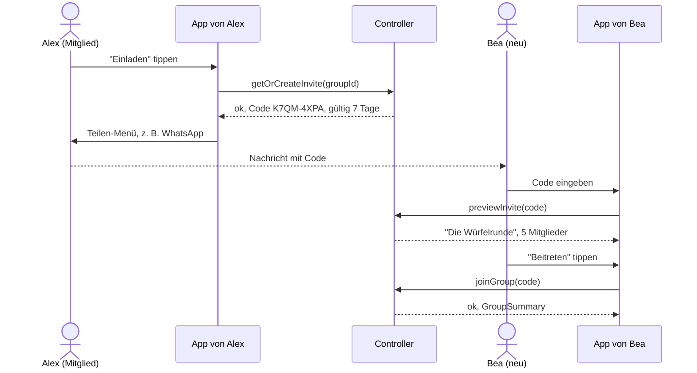

## Orte

Orte gehören zu einer Gruppe und können unabhängig von Terminen angelegt werden, z. B. "Bei
Alex" oder "Spieleladen Würfelglück".

```ts
export interface GroupLocation {
  id: string;
  groupId: string;
  label: string; // Kurzname, z. B. "Bei Alex"
  address: string;
  owner: UserRef | null; // Zuhause dieser Person, optional
  sessionCount: number; // Termine an diesem Ort, ohne abgesagte
  archived: boolean;
}

export interface LocationInput {
  label: string;
  address: string;
  ownerUserId?: string | null;
}

export function useLocations(
  groupId: string,
  options?: { includeArchived?: boolean },
): Loadable<GroupLocation[]>;
export function createLocation(
  groupId: string,
  input: LocationInput,
): Promise<ActionResult<GroupLocation>>; // jedes Mitglied
export function updateLocation(
  locationId: string,
  input: Partial<LocationInput>,
): Promise<ActionResult<GroupLocation>>; // Leitung
export function archiveLocation(locationId: string): Promise<ActionResult<void>>; // Leitung
```

- `label` 1 bis 40 Zeichen, `address` 3 bis 200 Zeichen.
- Archivierte Orte erscheinen nicht mehr in der Auswahl, bleiben aber an alten Terminen und in
  der Statistik erhalten. Endgültiges Löschen gibt es nicht.
- Hat ein Ort eine `owner`-Person, schlägt das Termin-Formular ihn vor, wenn diese Person
  Gastgeber:in ist.

## Übersicht (Story 1): `useUpcomingOverview()`

> Als Spieler:in will ich pro Gruppe und gesammelt den nächsten Session-Termin mit Zeit und Ort
> sehen.

```ts
export type SessionStatus = 'planned' | 'cancelled';

export interface SessionSummary {
  id: string;
  groupId: string;
  groupName: string;
  startsAt: Date;
  endsAt: Date;
  location: { id: string; label: string; address: string };
  host: UserRef | null; // null = Gastgeber:in offen
  status: SessionStatus;
  cancelReason: string | null;
  lateReportCount: number; // Story 6
  warnings: ScheduleWarning[]; // E1, leer = keine Überschneidung
}

export interface GroupNextSession {
  groupId: string;
  groupName: string;
  nextSession: SessionSummary | null;
}

export type TodoKind =
  | 'vote' // Abstimmung offen, noch nicht abgestimmt (Story 4)
  | 'choose-food' // Essensrichtung noch nicht gewählt (Story 7)
  | 'choose-delivery' // Gastgeber:in soll Lieferdienst wählen (Story 8)
  | 'order' // Bestellung noch nicht abgegeben (Story 9)
  | 'rate' // vergangener Termin noch nicht bewertet (Story 5)
  | 'assign-host'; // Leitung: Termin ohne Gastgeber:in

export interface Todo {
  kind: TodoKind;
  sessionId: string;
  groupName: string;
  sessionStartsAt: Date;
  dueAt: Date; // bis wann es erledigt sein sollte
}

export interface UpcomingOverview {
  nextOverall: SessionSummary | null;
  groups: GroupNextSession[];
  warningCount: number;
  todos: Todo[]; // aufsteigend nach dueAt
}

export function useUpcomingOverview(): Loadable<UpcomingOverview>;
```

Regeln:

- **"Kommend"** heißt geplant (`status: 'planned'`) und `startsAt >= jetzt`. Abgesagte Termine
  erscheinen hier nicht.
- **`nextOverall`:** frühester kommender Termin aller Gruppen, sonst `null`.
- **Sortierung von `groups`:** Gruppen mit Termin nach `startsAt`, danach Gruppen ohne Termin
  alphabetisch.
- **Hinweise (`todos`)** ersetzen Push-Erinnerungen. Sie erscheinen nur, solange das jeweilige
  Zeitfenster offen ist, und verschwinden, sobald die Aufgabe erledigt ist.
- **Keine Gruppe:** `ready` mit leeren Listen, die View zeigt einen Leerzustand.

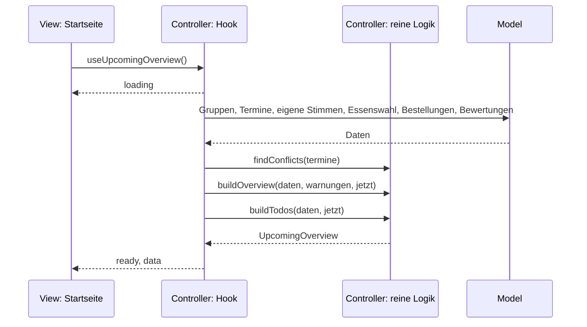

## Terminkalender

Alle Termine aus allen eigenen Gruppen, auch vergangene und abgesagte. Die Gruppenleitung legt
Termine an, ändert und sagt sie ab.

```ts
export interface DateRange {
  from: Date; // inklusive
  to: Date; // exklusive
}

export interface CalendarDay {
  date: Date; // 00:00 Uhr Ortszeit
  sessions: SessionSummary[]; // nach startsAt, abgesagte mit status 'cancelled'
  hasWarnings: boolean;
}

export interface CalendarFilter {
  groupIds?: string[]; // fehlend = alle eigenen Gruppen
  includeCancelled?: boolean; // Standard true
}

export function useCalendar(range: DateRange, filter?: CalendarFilter): Loadable<CalendarDay[]>;

export interface SessionDetails {
  session: SessionSummary;
  canEdit: boolean; // Leitung, solange der Termin nicht vorbei ist
  canChangeHost: boolean; // Leitung oder aktuelle Gastgeber:in
  phase: SessionPhase; // siehe Ablauf eines Termins
}

export function useSessionDetails(sessionId: string): Loadable<SessionDetails>;

export interface SessionDraft {
  groupId: string;
  startsAt: Date;
  durationMinutes: number; // 30 bis 1440, Vorschlag im Formular: 240
  locationId: string;
  hostUserId?: string; // fehlend = nächste Person laut Rotation
}

export type SessionChange = Partial<
  Pick<SessionDraft, 'startsAt' | 'durationMinutes' | 'locationId'>
>;

export interface SavedSession {
  session: SessionSummary;
  warnings: ScheduleWarning[];
}

/** Warnungen für einen Entwurf, ohne zu speichern. Bei Änderungen mit excludeSessionId. */
export function previewSession(
  draft: SessionDraft,
  options?: { excludeSessionId?: string },
): Promise<ActionResult<ScheduleWarning[]>>;

export function createSession(draft: SessionDraft): Promise<ActionResult<SavedSession>>; // Leitung
export function updateSession(
  sessionId: string,
  change: SessionChange,
): Promise<ActionResult<SavedSession>>; // Leitung
export function cancelSession(
  sessionId: string,
  reason?: string,
): Promise<ActionResult<SessionSummary>>; // Leitung
```

Regeln:

- **Rechte:** Anlegen, Ändern und Absagen nur durch die Gruppenleitung (`not-group-admin`).
- **Ändern:** nur, solange der Termin nicht beendet ist (`window-closed`). Wird `startsAt`
  verschoben, verschieben sich alle Zeitfenster mit. Bereits abgegebene Stimmen, Essenswahl und
  Bestellungen bleiben erhalten.
- **Absagen:** nur kommende Termine. Kein Löschen: der Termin bleibt mit `status: 'cancelled'`
  und optionalem Grund (bis 200 Zeichen) im Kalender sichtbar. Abgesagte Termine zählen nicht
  für Übersicht, Überschneidungen, Rotation, Statistik und Hinweise. Eine Absage kann nicht
  zurückgenommen werden, stattdessen wird ein neuer Termin angelegt.
- **Bereich:** `useCalendar` liefert jeden Tag im Bereich, auch leere. Höchstens 62 Tage, sonst
  `invalid-input`.
- **Validierung:** Ort muss zur Gruppe gehören und darf nicht archiviert sein, Gastgeber:in muss
  Mitglied sein, Dauer 30 bis 1440 Minuten. Fehler als `invalid-input` mit `field`.
  **Eine Überschneidung ist nie ein Fehler.**

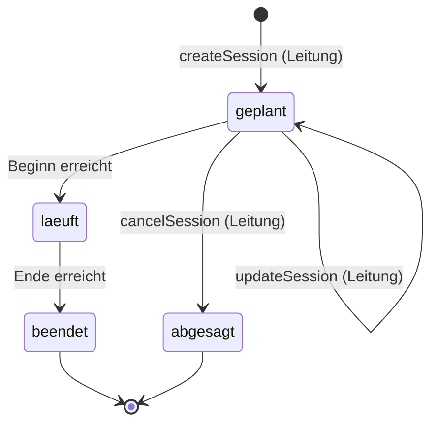

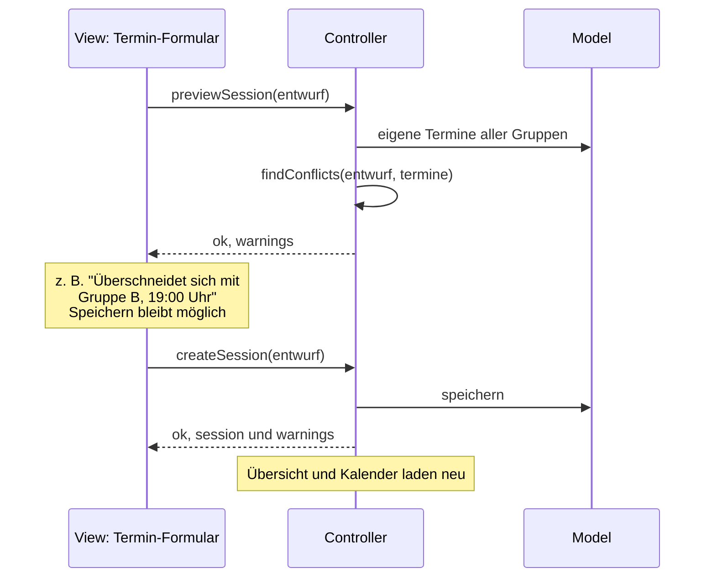

## Überschneidungen (E1)

> Als Spieler:in in mehreren Gruppen will ich vor Terminüberschneidungen gewarnt werden.

**Überschneidungen sind erlaubt und werden nur gewarnt.** Kein Termin wird deshalb abgelehnt,
verschoben oder ausgeblendet.

```ts
export type WarningKind =
  | 'overlap' // Zeiträume überlappen sich
  | 'same-day'; // gleicher Kalendertag ohne Überlappung

export interface ScheduleWarning {
  kind: WarningKind;
  other: {
    sessionId: string;
    groupId: string;
    groupName: string;
    startsAt: Date;
    endsAt: Date;
  };
}
```

| Fall                                                             | Ergebnis                   |
| ---------------------------------------------------------------- | -------------------------- |
| Termine A und B aus **verschiedenen** eigenen Gruppen überlappen | `overlap` an A und an B    |
| A und B am selben Kalendertag, ohne Überlappung                  | `same-day` an A und an B   |
| A endet genau, wenn B beginnt                                    | `same-day`                 |
| A und B aus **derselben** Gruppe                                 | keine Warnung              |
| A oder B abgesagt                                                | keine Warnung              |
| beliebig viele Termine gleichzeitig                              | jede Paarung wird gemeldet |

- Überlappung heißt `A.startsAt < B.endsAt` und `B.startsAt < A.endsAt`.
- Geprüft werden nur Termine der angemeldeten Person, also aus ihren Gruppen.
- Vorschlag für die View: `overlap` als deutliche Warnung, `same-day` als leiser Hinweis.

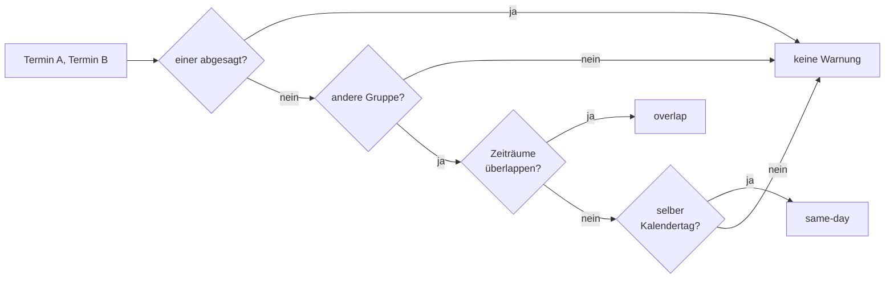

## Gastgeber-Rotation (Story 2)

> Als Spieler:in will ich, dass der Gastgeber-Ort in der Gruppe rotiert, damit der Aufwand fair
> verteilt ist.

```ts
export interface HostRotation {
  order: GroupMember[]; // feste Reihenfolge
  nextHost: GroupMember | null; // wer beim nächsten neuen Termin dran ist
  canEdit: boolean; // Leitung
}

export function useHostRotation(groupId: string): Loadable<HostRotation>;

/** Reihenfolge ändern. Nur Leitung. memberIds = genau alle Mitglieder. */
export function reorderHosts(
  groupId: string,
  memberIds: string[],
): Promise<ActionResult<HostRotation>>;

/** Vertretung bei Ausfall: andere Person übernimmt einen Termin. Leitung oder aktuelle Gastgeber:in. */
export function setSessionHost(
  sessionId: string,
  userId: string,
): Promise<ActionResult<SessionSummary>>;

/** Tausch: zwei Termine derselben Gruppe tauschen ihre Gastgeber:innen.
 *  Leitung oder eine der beiden Gastgeber:innen. */
export function swapSessionHosts(
  sessionIdA: string,
  sessionIdB: string,
): Promise<ActionResult<[SessionSummary, SessionSummary]>>;
```

Regeln:

- Jeder Termin merkt sich, **wer laut Rotation dran war** (geplant) und **wer tatsächlich
  Gastgeber:in ist**. Vertretung und Tausch ändern nur die tatsächliche Person.
- **Nächste Person:** das Mitglied nach der laut Rotation geplanten Person des letzten nicht
  abgesagten Termins. Am Ende geht es von vorn los. Ohne bisherigen Termin beginnt die
  Reihenfolge vorn. Ist die geplante Person nicht mehr Mitglied, geht es vorn weiter.
- **Fairness:** Wer bei Ausfall vertreten wird, verliert seinen Platz nicht dauerhaft, da die
  Rotation an der geplanten Person weiterläuft. Für einen echten Ausgleich ist der Tausch gedacht.
- **Abgesagte Termine** zählen nicht. Die geplante Person ist beim nächsten Termin wieder dran.
- Vertretung und Tausch nur für kommende, nicht abgesagte Termine, sonst `window-closed` bzw.
  `session-cancelled`. Neue Gastgeber:in muss Mitglied sein.
- `reorderHosts` mit fehlenden oder doppelten IDs liefert `invalid-input`.

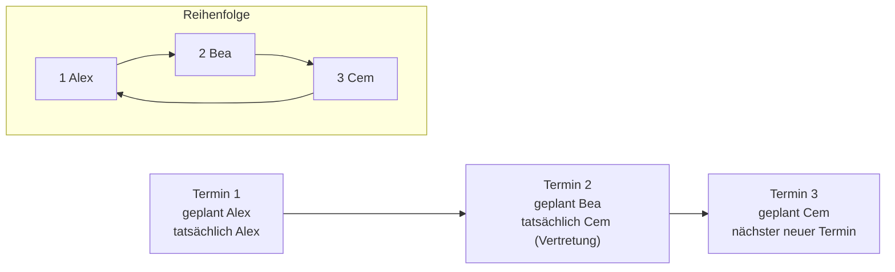

## Ablauf eines Termins

Stories 3 bis 9 hängen an festen Zeitfenstern relativ zum Beginn eines Termins. Alle Werte
sind Konstanten im Controller und damit leicht änderbar.

```ts
export type SessionPhase =
  | 'upcoming' // geplant, Beginn in der Zukunft
  | 'running' // zwischen Beginn und Ende
  | 'finished' // vorbei
  | 'cancelled';

export interface TimeWindow {
  opensAt: Date;
  closesAt: Date;
  isOpen: boolean;
}
```

| Fenster                   | öffnet                 | schließt          | Konstante                                                      |
| ------------------------- | ---------------------- | ----------------- | -------------------------------------------------------------- |
| Vorschläge und Abstimmung | Termin angelegt        | 24 h vor Beginn   | `VOTING_CLOSES_HOURS_BEFORE = 24`                              |
| Essensrichtung wählen     | 48 h vor Beginn        | 4 h vor Beginn    | `FOOD_OPENS_HOURS_BEFORE = 48`, `FOOD_CLOSES_HOURS_BEFORE = 4` |
| Lieferdienst wählen       | Essenswahl geschlossen | Beginn            | -                                                              |
| Bestellung abgeben        | Lieferdienst gewählt   | Beginn            | -                                                              |
| Verspätung melden         | 12 h vor Beginn        | Ende              | `LATE_OPENS_HOURS_BEFORE = 12`                                 |
| Bewerten                  | Ende                   | 14 Tage nach Ende | `RATING_OPEN_DAYS = 14`                                        |

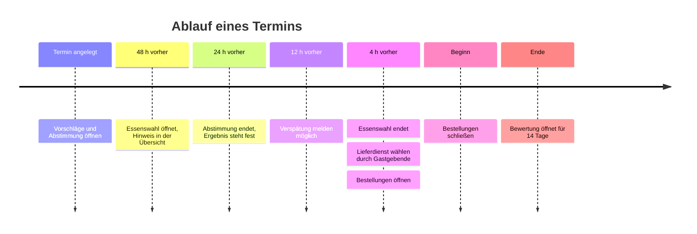

Außerhalb eines Fensters liefern die ändernden Funktionen `window-closed`. Bei abgesagten
Terminen liefern sie `session-cancelled`.

## Vorschläge und Abstimmung (Story 3 und 4)

> Als Spieler:in will ich Inhalte für die nächste Session vorschlagen und vor dem Termin über
> die Vorschläge abstimmen.

```ts
export type ProposalKind = 'one-shot' | 'module' | 'campaign-focus';

export interface Proposal {
  id: string;
  kind: ProposalKind;
  title: string;
  description: string | null;
  author: UserRef;
  createdAt: Date;
  voteCount: number;
  votedByMe: boolean;
  canDelete: boolean; // Autor:in oder Leitung, solange die Abstimmung offen ist
}

export interface ProposalBoard {
  window: TimeWindow;
  proposals: Proposal[]; // nach voteCount absteigend, dann createdAt
  myVoteProposalId: string | null;
  winner: Proposal | null; // erst nach Ende der Abstimmung
  voterCount: number;
}

export interface ProposalInput {
  kind: ProposalKind;
  title: string; // 3 bis 80 Zeichen
  description?: string; // bis 500 Zeichen
}

export function useProposals(sessionId: string): Loadable<ProposalBoard>;
export function propose(sessionId: string, input: ProposalInput): Promise<ActionResult<Proposal>>;
export function deleteProposal(proposalId: string): Promise<ActionResult<void>>;
export function vote(proposalId: string): Promise<ActionResult<ProposalBoard>>;
export function withdrawVote(sessionId: string): Promise<ActionResult<ProposalBoard>>;
```

- Jedes Mitglied darf beliebig viele Vorschläge machen, solange die Abstimmung offen ist.
- **Eine Stimme je Person und Termin.** Erneutes `vote` verschiebt die Stimme. Zwischenstände
  sind für alle sichtbar, wer wofür gestimmt hat nicht.
- **Ergebnis:** meiste Stimmen gewinnt. Bei Gleichstand gewinnt der früher eingereichte
  Vorschlag. Ohne Stimmen gibt es keinen Gewinner.
- Wird ein Vorschlag gelöscht, verfallen seine Stimmen.

## Bewertung (Story 5)

> Als Spieler:in will ich nach der Session Gastgeber:in, Verpflegung und Abend bewerten.

```ts
export type Score = 1 | 2 | 3 | 4 | 5;

export interface RatingInput {
  host?: Score; // entfällt für die Gastgeber:in selbst
  food?: Score; // optional, falls es kein Essen gab
  evening: Score;
}

export interface Average {
  average: number; // auf eine Nachkommastelle gerundet
  count: number;
}

export interface RatingSummary {
  window: TimeWindow;
  myRating: RatingInput | null;
  canRateHost: boolean; // false für die Gastgeber:in
  host: Average | null; // null ohne Bewertungen
  food: Average | null;
  evening: Average | null;
}

export function useRatings(sessionId: string): Loadable<RatingSummary>;
export function rateSession(
  sessionId: string,
  input: RatingInput,
): Promise<ActionResult<RatingSummary>>;
```

- Bewerten nur durch Mitglieder, nur im Bewertungsfenster, einmal je Termin. Erneutes
  `rateSession` überschreibt die eigene Bewertung.
- Die Gastgeber:in bewertet sich nicht selbst, `host` wird bei ihr mit `invalid-input` abgelehnt.
- Einzelbewertungen bleiben anonym, angezeigt werden nur Durchschnitte.

## Verspätung melden (Story 6)

> Als Spieler:in will ich allen Gruppenmitgliedern schnell melden können, dass ich später komme.

```ts
export interface LateReport {
  user: UserRef;
  minutesLate: number;
  note: string | null;
  reportedAt: Date;
}

export interface LateReportInput {
  minutesLate: number; // 5 bis 240
  note?: string; // bis 140 Zeichen
}

export function useLateReports(sessionId: string): Loadable<LateReport[]>;
export function reportLate(
  sessionId: string,
  input: LateReportInput,
): Promise<ActionResult<LateReport>>;
export function withdrawLateReport(sessionId: string): Promise<ActionResult<void>>;
```

- Eine Meldung je Person und Termin, erneutes Melden überschreibt.
- Ohne Push sehen die anderen die Meldung in der App: an der Termin-Detailseite und als
  `lateReportCount` in der Übersicht und im Kalender.

## Essen (Story 7 bis 9)

> 7: Als Spieler:in will ich rechtzeitig erinnert werden, meine Essensrichtung zu wählen.
> 8: Als Gastgeber:in will ich rechtzeitig die mehrheitliche Essensrichtung erfahren, um einen
> Lieferdienst auszusuchen.
> 9: Als Spieler:in will ich das Menü des gewählten Lieferdienstes sehen, um meine Bestellung zu
> übermitteln.

Lieferdienste und Menüs sind ein **Stub**: feste Beispieldaten im Controller, keine echte
Anbindung. Bestellungen werden in der App gesammelt, die Gastgeber:in bestellt selbst.

```ts
export type Cuisine = 'pizza' | 'burger' | 'asian' | 'indian' | 'mexican' | 'vegetarian';

export interface CuisineCount {
  cuisine: Cuisine;
  count: number;
}

export interface FoodPoll {
  window: TimeWindow;
  myChoice: Cuisine | null;
  tally: CuisineCount[]; // nach count absteigend
  majority: Cuisine[]; // mehrere bei Gleichstand, leer ohne Stimmen
  isHost: boolean;
  deliveryService: DeliveryService | null; // von der Gastgeber:in gewählt
}

export interface MenuItem {
  id: string;
  name: string;
  description: string;
  priceCents: number;
}

export interface DeliveryService {
  id: string;
  name: string;
  cuisine: Cuisine;
  menu: MenuItem[];
}

export interface OrderLine {
  itemId: string;
  quantity: number; // 1 bis 20
}

export interface Order {
  user: UserRef;
  lines: Array<OrderLine & { item: MenuItem }>;
  note: string | null;
  totalCents: number;
}

export interface OrderOverview {
  window: TimeWindow;
  deliveryService: DeliveryService | null;
  myOrder: Order | null;
  allOrders: Order[]; // nur für die Gastgeber:in gefüllt, sonst []
  totalCents: number; // Summe aller Bestellungen, nur für die Gastgeber:in
}

export function useFoodPoll(sessionId: string): Loadable<FoodPoll>;
export function chooseCuisine(sessionId: string, cuisine: Cuisine): Promise<ActionResult<FoodPoll>>;
export function clearCuisine(sessionId: string): Promise<ActionResult<FoodPoll>>;

/** Story 8: passende Lieferdienste zur Mehrheit. */
export function useDeliveryServices(sessionId: string): Loadable<DeliveryService[]>;
/** Nur Gastgeber:in oder Leitung, nach Ende der Essenswahl. */
export function chooseDeliveryService(
  sessionId: string,
  serviceId: string,
): Promise<ActionResult<FoodPoll>>;

/** Story 9 */
export function useOrders(sessionId: string): Loadable<OrderOverview>;
export function submitOrder(
  sessionId: string,
  lines: OrderLine[],
  note?: string,
): Promise<ActionResult<Order>>;
export function withdrawOrder(sessionId: string): Promise<ActionResult<void>>;
```

- **Story 7:** Ab 48 h vor Beginn erscheint der Hinweis `choose-food` in der Übersicht, bis
  gewählt ist oder das Fenster schließt. Eine Wahl je Person, änderbar bis 4 h vorher.
- **Story 8:** Die Auszählung ist für alle sichtbar. Nach Ende der Essenswahl erhält die
  Gastgeber:in den Hinweis `choose-delivery`. `useDeliveryServices` liefert Dienste passend zur
  Mehrheit, bei Gleichstand zu allen Gewinnern, ohne Stimmen alle.
- **Story 9:** Sobald ein Dienst gewählt ist, sehen alle das Menü und erhalten den Hinweis
  `order`. Eine Bestellung je Person, änderbar bis Beginn. Die Gastgeber:in sieht alle
  Bestellungen und die Summe. Bezahlung ist nicht Teil der App.

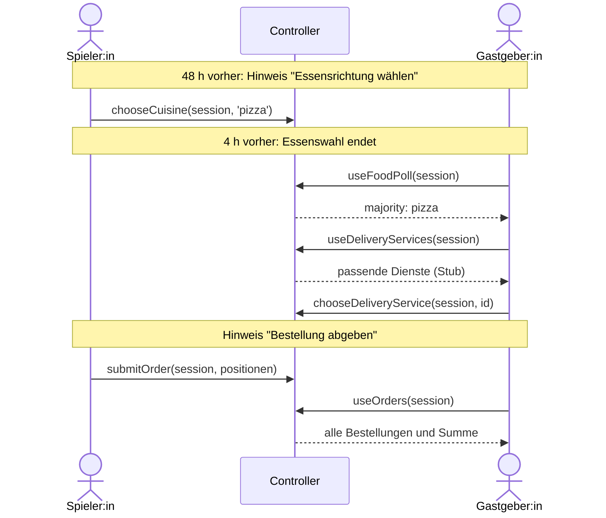

## Statistik der Spielorte (E2)

> Als Spieler:in will ich eine Statistik sehen, wo die meisten Termine stattfanden.

```ts
export interface LocationStat {
  label: string;
  address: string;
  count: number; // stattgefundene Termine
  share: number; // Anteil 0 bis 1
  lastSessionAt: Date;
  groupNames: string[];
}

export function useLocationStats(filter?: { groupId?: string }): Loadable<LocationStat[]>;
```

- Gezählt werden nur stattgefundene Termine: nicht abgesagt und `startsAt < jetzt`.
- Gleiche Adressen werden zusammengefasst, auch über Gruppen hinweg (ohne Groß- und
  Kleinschreibung und doppelte Leerzeichen). `label` ist der zuletzt verwendete Kurzname.
- Archivierte Orte zählen mit.
- Sortierung: `count` absteigend, bei Gleichstand Adresse alphabetisch.

## Typen im Überblick

Gruppen und Termine:

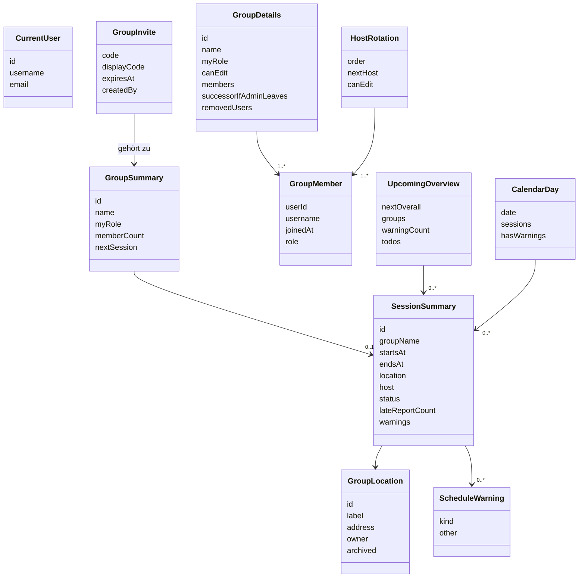

Rund um einen Termin:

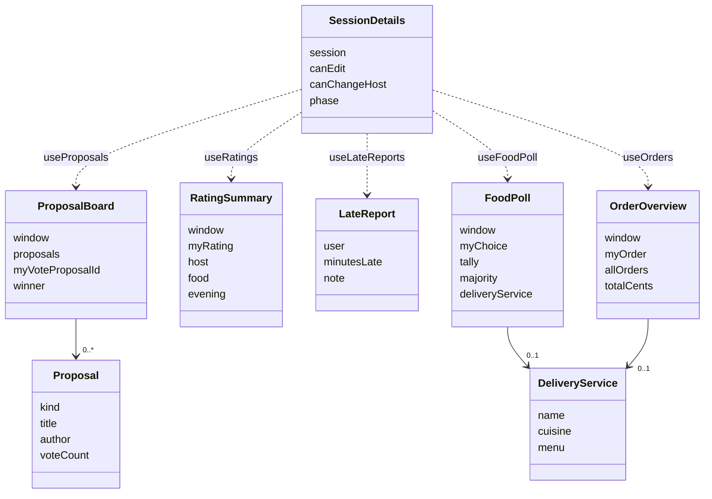

## Annahmen

Von Maikel festgelegt oder als Vorschlag gesetzt. Abweichungen bitte im Review anmerken.

| Annahme                                                                 | Wo              |
| ----------------------------------------------------------------------- | --------------- |
| Termine anlegen, ändern und absagen nur durch die Gruppenleitung        | Kalender        |
| Jedes Mitglied darf den Einladungscode teilen, nur die Leitung erneuert | Einladungen     |
| Jedes Mitglied darf Orte anlegen, nur die Leitung ändert und archiviert | Orte            |
| Letztes Mitglied tritt aus: Gruppe wird gelöscht                        | Gruppen         |
| Eine Stimme je Person und Termin, Gleichstand: früherer Vorschlag       | Story 4         |
| Bewertungen anonym, nur Durchschnitte sichtbar                          | Story 5         |
| Zeitfenster laut Tabelle im Abschnitt "Ablauf eines Termins"            | Stories 3 bis 9 |
| Lieferdienste als Stub, keine Bezahlung                                 | Story 9         |
| Keine Push-Benachrichtigungen, nur Hinweise in der App                  | Story 6, 7      |

## Offene Punkte

| Thema                        | Frage                                                                                                           | Wer           |
| ---------------------------- | --------------------------------------------------------------------------------------------------------------- | ------------- |
| Direkter Link in die App     | Soll der geteilte Text einen Link enthalten, der die App mit Code öffnet? Braucht ein URL-Schema in `app.json`. | Karin         |
| Alten Stand beim Neuladen    | Soll `reload()` den alten Stand bis zum Ergebnis zeigen (`refreshing`)?                                         | Karin, Maikel |
| Kampagne vs. One-Shot        | Gruppen mit fester Kampagne brauchen evtl. keine Abstimmung. Gruppentyp einführen?                              | Team          |
| Spielleitung (DM)            | Eigenes Rollenfeld für die Person, die das Spiel leitet, unabhängig von der Gastgeber:in?                       | Team          |
| Freiwillige Leitungsübergabe | Übergabe per Anfrage und Zustimmung                                                                             | später        |
| Push-Benachrichtigungen      | Erst nach den Pflicht-Stories                                                                                   | später        |
