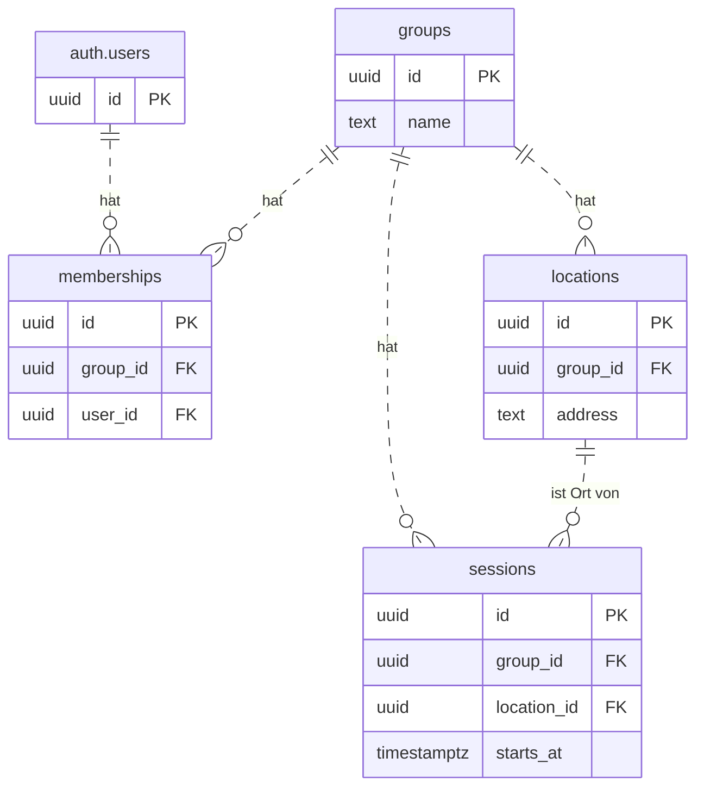

# Datenmodell – User Story 1

Implementierter Stand vom 03.11.2026: vier Anwendungstabellen im Schema `public`
für Gruppen und ihre Session-Termine mit Zeit und Ort.
Maßgeblich sind die [SQL-Migrationen](../supabase/migrations/).

`auth.users` gehört zu Supabase Auth. Die Tabelle wird hier nur mit ihrer ID
als Referenz dargestellt und nicht durch unsere Migrationen angelegt.

`PK` = Primärschlüssel, `FK` = Fremdschlüssel. `||` bedeutet genau einen
Datensatz, `o{` bedeutet null bis beliebig viele Datensätze.
Alle Spalten der vier Anwendungstabellen sind Pflichtfelder.

## Datenbankregeln

- `UNIQUE (group_id, user_id)` verhindert doppelte Mitgliedschaften in derselben Gruppe.
- `UNIQUE (group_id, id)` in `locations` ermöglicht den zusammengesetzten
  Fremdschlüssel `sessions (group_id, location_id) → locations (group_id, id)`.
  Damit darf eine Session nur einen Ort ihrer eigenen Gruppe verwenden.

## Datenzugriff

- `getGroupsForUser(userId)` liefert die Gruppen des angegebenen Nutzers.
- `getSessionsForGroup(groupId)` liefert die Sessions dieser Gruppe mit Ort,
  aufsteigend nach `starts_at` sortiert. Der Controller bestimmt daraus die nächste Session.
- Eine Anmeldung zur Teilnahme an einer Session (RSVP) ist zum Anzeigen nicht erforderlich.
- `signIn(email, password)` meldet einen bestehenden Account an und liefert
  dessen `id` und `email`.

RLS beschränkt Lesezugriffe auf angemeldete Gruppenmitglieder. Mitgliedschaften
sind nur für den jeweiligen Nutzer sichtbar. Nicht angemeldete Clients haben
keinen Lesezugriff; Schreibzugriffe aus der App sind gesperrt.
