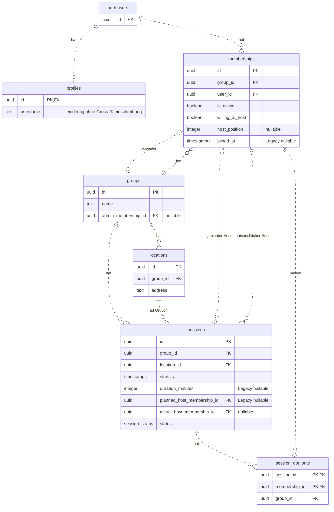

# Datenmodell – US1, US2 und gemeinsame Grundlagen

Stand: 08.11.2026. Die US2-Erweiterungen und die Profilfunktionen wurden lokal
implementiert und geprüft. Profile bilden eine gemeinsame technische Grundlage.

Maßgeblich sind die [SQL-Migrationen](../supabase/migrations/).
`auth.users` wird von Supabase Auth verwaltet.

## Tabellen und Beziehungen

`PK` = Primärschlüssel, `FK` = Fremdschlüssel. `||` bedeutet genau einen
Datensatz, `|o` beziehungsweise `o|` null oder einen und `o{` null bis
beliebig viele.

`session_status` enthält `scheduled`, `completed` und `cancelled`.
Ein vergangener Termin allein ändert den Status nicht.

## Profile und Registrierung

`profiles.id` ist Primärschlüssel und Fremdschlüssel auf `auth.users.id`.
Pro Konto gibt es höchstens ein Profil. Beim Löschen des Auth-Kontos wird
sein Profil mitgelöscht. Mitgliedschaften referenzieren `auth.users`.

Die Registrierung verlangt Benutzername, E-Mail und Passwort. Ein Trigger
auf `auth.users` legt das Profil in derselben Transaktion wie das Konto an.
Beim Anlegen und Ändern des Profils wird äußerer Leerraum entfernt. Der
Benutzername muss danach mindestens ein Zeichen enthalten. Ein eindeutiger
Index auf `lower(username)` sichert die Eindeutigkeit unabhängig von Groß-
und Kleinschreibung. Schlägt die Profilanlage fehl, wird die Registrierung
zurückgerollt.

Bestehende Konten ohne Profil bleiben nutzbar. Ihre Inhaber können ihr
Profil über `save_own_profile` anlegen und ändern. Die Funktion ermittelt
die Nutzer-ID aus der angemeldeten Sitzung.

Angemeldete Nutzer dürfen ihr eigenes Profil lesen. Andere Profile sind
sichtbar, wenn beide Nutzer aktive Mitgliedschaften in mindestens einer
gemeinsamen Gruppe haben.

## Session-Dauer

`sessions.duration_minutes` ist eine Ganzzahl ohne Standardwert.
Gesetzte Werte liegen einschließlich der Grenzen zwischen 30 und 1440 Minuten.
Bestehende Sessions dürfen `NULL` behalten.

Die geschützten Operationen `create_session` und `update_session` verlangen
eine gültige Dauer. Das gilt auch beim Bearbeiten einer alten Session.
Dauer, Session-Daten und optionale Orts- und Positionsänderungen werden
gemeinsam gespeichert.

Der erwartete Session-Zustand enthält `duration_minutes`, bei Altdaten
auch `null`. Eine konkurrierende Änderung allein an der Dauer führt bei
einem veralteten Snapshot zu `PT409`.

## Mitgliedschaft und Hosting-Reihenfolge

- Eine aktuelle Mitgliedschaft erfordert die passende Gruppe und Nutzer-ID
  sowie `is_active = true`.
- Beim Austritt bleibt derselbe Datensatz mit `is_active = false` erhalten,
  solange weitere aktive Mitglieder bleiben. Sein `host_position` wird
  geleert. Historische Hostreferenzen bleiben gültig.
- Beim Wiedereintritt in eine bestehende Gruppe wird derselbe Datensatz
  reaktiviert. `joined_at` bezeichnet dann den Beginn der neuen
  ununterbrochenen Mitgliedschaft. Die bisherige Hosting-Bereitschaft
  bleibt erhalten, die frühere Position wird nicht wiederhergestellt.
- `host_position` speichert die Reihenfolge innerhalb einer Gruppe.
  Eine gesetzte Position ist positiv, innerhalb der Gruppe eindeutig und
  nur für aktive, hostingbereite Mitglieder zulässig.
- `NULL` bedeutet keine zugewiesene Position. Lücken sind erlaubt.
  Verschiedene Gruppen dürfen dieselben Positionsnummern verwenden.
- Die Eindeutigkeitsprüfung ist aufschiebbar, damit Positionen atomar
  getauscht werden können.

## Administration und Sessions

- Die geschützte Gruppenerstellung speichert Gruppe, aktive Mitgliedschaft
  des Erstellers und Administratorreferenz gemeinsam.
- Beim Austritt des Administrators ist ein aktiver Nachfolger derselben
  Gruppe erforderlich, solange weitere aktive Mitglieder bleiben. Der
  Controller wählt den Nachfolger aus, die Austrittsoperation speichert ihn.
- Beim Austritt des letzten aktiven Mitglieds werden die Gruppe, ihre Sessions,
  Orte und alle Mitgliedschaften einschließlich inaktiver Mitgliedschaften in
  einer Transaktion gelöscht. Auth-Accounts, Profile und andere Gruppen bleiben
  erhalten.
- Ein Wiedereintritt stellt eine frühere Administratorrolle nicht wieder her.
- Geplanter und tatsächlicher Host werden getrennt gespeichert. Die geschützte
  Bestätigung speichert den tatsächlichen Host und `completed` gemeinsam.
  Der geplante Host bleibt erhalten.

Hostauswahl, Rotationsfortschritt, Buchungs- und Stornierungsverarbeitung,
Tauschlogik und Nachfolgeauswahl gehören zum Controller. Die Datenbank prüft
Berechtigungen und Integrität und speichert zusammengehörige Änderungen atomar.

## Persönliche Session-Absagen

`session_opt_outs` speichert pro Session und Mitgliedschaft höchstens eine
persönliche Absage. Zusammengesetzte Fremdschlüssel stellen sicher, dass
Session und Mitgliedschaft derselben Gruppe angehören. Beim Löschen einer
Session werden ihre Absagen mitgelöscht.

## Integrität und Übergangsdaten

- `UNIQUE (group_id, user_id)` verhindert doppelte Mitgliedschaften.
- Zusammengesetzte Fremdschlüssel halten die Administratorreferenz,
  beide Hostreferenzen und den Session-Ort innerhalb derselben Gruppe.
  Grundlage sind eindeutige Kombinationen aus `group_id` und `id`
  in `memberships` beziehungsweise `locations`.

| Feld | Bedeutung von `NULL` |
| --- | --- |
| `groups.admin_membership_id` | Bestehende Testgruppe ohne initialisierte Administration. |
| `memberships.host_position` | Keine zugewiesene Hosting-Position. |
| `memberships.joined_at` | Bestehende Legacy-Testdaten ohne bekannten Beginn. |
| `sessions.planned_host_membership_id` | Bestehende Legacy-Testdaten ohne geplanten Host. |
| `sessions.actual_host_membership_id` | Noch kein tatsächlicher Host festgelegt. Bei `completed` ist er erforderlich. |
| `sessions.duration_minutes` | Unbekannte Dauer einer alten Session. |

`CHECK ... NOT VALID` erlaubt bestehende Legacy-Zeilen ohne `joined_at`
beziehungsweise geplanten Host. Neue und aktualisierte Zeilen müssen die
jeweilige Prüfung erfüllen.

## Datenzugriff

RLS erlaubt angemeldeten aktuellen Mitgliedern den Zugriff auf ihre Gruppe,
deren Orte, Sessions und Mitgliedschaften. Erhaltene Mitgliedschaften
ausgetretener Nutzer gewähren keinen weiteren Zugriff. Anonyme Zugriffe
und direkte Tabellenänderungen aus der App sind gesperrt.

Die öffentlichen Lese- und Schreiboperationen stehen in der
[Model-API](model-api.md). Einrichtung und lokale Prüfung sind in
[Supabase](supabase.md) dokumentiert.
