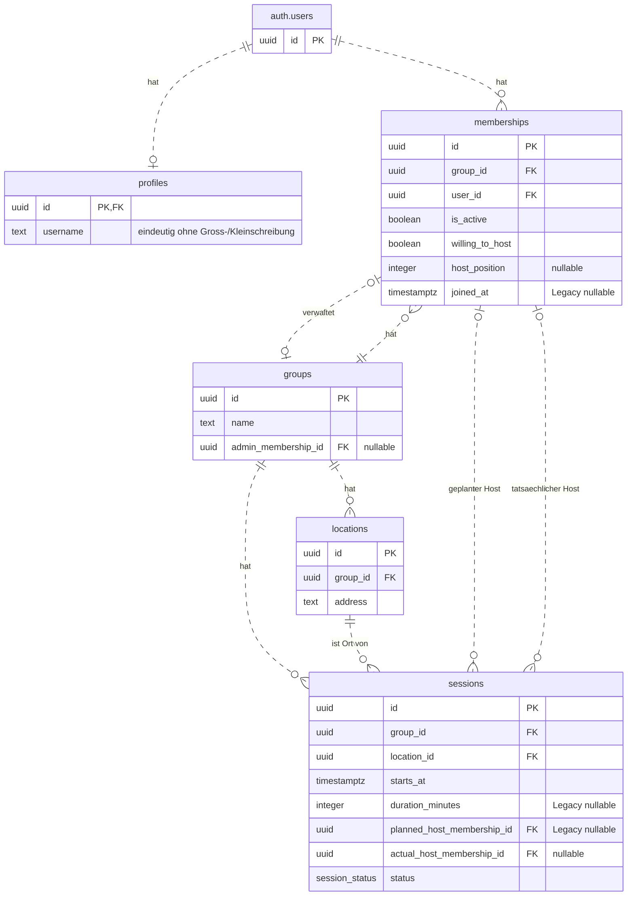

# Datenmodell – User Story 1 und 2 und gemeinsame Grundlagen

Stand: 08.11.2026. Die US2-Erweiterungen sind auf dem Feature-Branch lokal
implementiert und getestet. Profile ergänzen die gemeinsame technische Grundlage;
sie sind keine Anforderung aus US2. Die US2- und Profil-Migrationen wurden in
diesem Arbeitsstand nur lokal angewendet.

Maßgeblich sind die [SQL-Migrationen](../supabase/migrations/).
`auth.users` gehört zu Supabase Auth und wird nicht durch unsere Migrationen
angelegt.

## Tabellen und Beziehungen

`PK` = Primärschlüssel, `FK` = Fremdschlüssel. `||` bedeutet genau einen,
`|o` beziehungsweise `o|` null oder einen und `o{` null bis beliebig viele
Datensätze.

`session_status` enthält `scheduled`, `completed` und `cancelled`.
Ein vergangener Termin allein ändert den Status nicht.

## Profile und Registrierung

`profiles.id` ist Primärschlüssel und Fremdschlüssel auf `auth.users.id`.
Pro Konto gibt es höchstens ein Profil. Beim Löschen des Auth-Kontos wird
sein Profil mitgelöscht. Mitgliedschaften referenzieren `auth.users`.

Die Registrierung verlangt Benutzername, E-Mail und Passwort. Ein Trigger
auf `auth.users` legt das Profil in derselben Transaktion wie das Konto an.
Beim Anlegen und Ändern des Profils wird äußerer Leerraum entfernt. Der
Benutzername muss danach nicht leer sein. Ein eindeutiger Index auf
`lower(username)` sichert die Eindeutigkeit unabhängig von Groß- und
Kleinschreibung. Schlägt die Profilanlage fehl, wird die Registrierung
zurückgerollt.

Bestehende Konten ohne Profil bleiben nutzbar. Ihre Inhaber können ein
Profil über `save_own_profile` anlegen und später ändern. Die Funktion
ermittelt die Nutzer-ID aus der angemeldeten Sitzung und erlaubt Änderungen
ausschließlich am eigenen Profil.

Angemeldete Nutzer dürfen ihr eigenes Profil lesen. Andere Profile sind
sichtbar, wenn beide Nutzer aktive Mitgliedschaften in mindestens einer
gemeinsamen Gruppe haben. Direkte Tabellenänderungen aus der App und
anonyme Zugriffe sind gesperrt.

## Session-Dauer

`sessions.duration_minutes` ist eine Ganzzahl ohne Standardwert.
Gesetzte Werte liegen einschließlich der Grenzen zwischen 30 und 1440 Minuten.
Bestehende Sessions dürfen `NULL` behalten; eine unbekannte Dauer wird nicht
nachträglich geschätzt.

Die geschützten Operationen `create_session` und `update_session` verlangen
`session_duration_minutes` mit einem gültigen Wert. Auch beim Bearbeiten einer
alten Session muss die Dauer angegeben werden. Dauer, Session-Daten und optionale
Orts- und Positionsänderungen werden innerhalb derselben Transaktion gespeichert.

Der erwartete Session-Zustand enthält `duration_minutes`, bei Altdaten auch
`null`. Bearbeiten, Absagen, Benennen des tatsächlichen Hosts und Bestätigen
vergleichen dieses Feld mit dem gespeicherten Wert. Schon eine konkurrierende
Änderung allein an der Dauer führt bei einem veralteten Snapshot zu `PT409`.

## Mitgliedschaft und Hosting-Reihenfolge

- Eine aktuelle Mitgliedschaft erfordert die passende Gruppe und Nutzer-ID
  sowie `is_active = true`. Das Vorhandensein eines Mitgliedschaftsdatensatzes
  allein genügt nicht.
- Beim Austritt bleibt derselbe Datensatz mit `is_active = false` erhalten.
  Sein `host_position` wird geleert; historische Hostreferenzen bleiben gültig.
- Beim Wiedereintritt wird derselbe Datensatz reaktiviert. `joined_at` wird auf
  den Beginn der neuen ununterbrochenen Mitgliedschaft gesetzt.
  Die bisherige Hosting-Bereitschaft bleibt erhalten; die frühere Position
  wird nicht wiederhergestellt.
- `host_position` speichert die Reihenfolge innerhalb einer Gruppe.
  Eine gesetzte Position ist positiv, innerhalb der Gruppe eindeutig und
  nur für aktive, hostingbereite Mitglieder zulässig.
- `NULL` bedeutet keine zugewiesene Position. Lücken sind erlaubt.
  Verschiedene Gruppen dürfen dieselben Positionsnummern verwenden.
- Die Eindeutigkeit ist aufschiebbar, damit Positionen innerhalb einer
  geschützten Speicheroperation atomar getauscht werden können.

## Administration und Sessions

- Die geschützte Gruppenerstellung speichert Gruppe, aktive Mitgliedschaft
  des Erstellers und Administratorreferenz gemeinsam.
- Beim Austritt des Administrators speichert die Austrittsoperation einen
  ausdrücklich übergebenen, anderen aktiven Nachfolger derselben Gruppe.
  Solange weitere aktive Mitglieder vorhanden sind, ist ein Nachfolger nötig.
- Verlässt das letzte Mitglied die Gruppe, wird `admin_membership_id` auf
  `NULL` gesetzt. Gruppe und historische Mitgliedschaft bleiben erhalten.
- Ein Wiedereintritt stellt eine frühere Administratorrolle nicht wieder her.
- Geplanter und tatsächlicher Host werden getrennt gespeichert.
  Eine Session mit `status = completed` benötigt einen tatsächlichen Host.
- Die geschützte Bestätigung speichert tatsächlichen Host und Abschlussstatus
  gemeinsam und erhält den geplanten Host.

Hostauswahl, Rotationsfortschritt, Buchungs- und Stornierungsverarbeitung,
Tauschlogik sowie die Auswahl des ältesten verbleibenden Mitglieds als
Nachfolger gehören zum Controller. Die Datenbank prüft Berechtigungen und
Integrität und speichert zusammengehörige Änderungen atomar.

## Integrität und Übergangsdaten

- `UNIQUE (group_id, user_id)` verhindert doppelte Mitgliedschaften.
- Zusammengesetzte Fremdschlüssel halten die Administratorreferenz,
  beide Hostreferenzen und den Session-Ort innerhalb derselben Gruppe.
  Grundlage sind eindeutige Kombinationen aus `group_id` und `id`
  in `memberships` beziehungsweise `locations`.

| Feld                                  | Bedeutung von `NULL`                                                                         |
| ------------------------------------- | -------------------------------------------------------------------------------------------- |
| `groups.admin_membership_id`          | Bestehende Testgruppe ohne initialisierte Administration oder Gruppe ohne aktive Mitglieder. |
| `memberships.host_position`           | Keine zugewiesene Hosting-Position.                                                          |
| `memberships.joined_at`               | Nur bestehende Legacy-Testdaten ohne bekannten Beginn.                                       |
| `sessions.planned_host_membership_id` | Nur bestehende Legacy-Testdaten ohne geplanten Host.                                         |
| `sessions.actual_host_membership_id`  | Noch kein tatsächlicher Host festgelegt; bei `completed` unzulässig.                         |
| `sessions.duration_minutes`           | Unbekannte Dauer einer alten Session; beim Erstellen und Bearbeiten per RPC unzulässig.      |

Die erforderlichen Werte für `joined_at` und `planned_host_membership_id`
werden durch `CHECK ... NOT VALID` abgesichert. Bestehende Legacy-Zeilen
können zunächst `NULL` behalten; neue und aktualisierte Zeilen müssen
die Prüfungen erfüllen. Alte Beitrittszeiten werden nicht erfunden.

## Datenzugriff

- `getGroupsForUser(userId)` liefert Gruppen über aktive Mitgliedschaften
  des angegebenen Nutzers innerhalb der RLS-Berechtigungen des Aufrufers.
- `getActiveMembersForGroup(groupId)` liefert aktuelle Mitglieder mit
  Hosting-Bereitschaft und Position.
- `getMembersForGroupIncludingInactive(groupId)` liefert auch die erhaltenen
  Mitgliedschaften ehemaliger Mitglieder.
- `isActiveGroupMember(groupId, userId)` prüft eine aktuelle Mitgliedschaft.
- `getSessionsForGroup(groupId)` liefert Sessions aller Status mit Ort,
  aufsteigend nach `starts_at`. Der Controller bestimmt die nächste Session.
- `signIn(email, password)` meldet einen bestehenden Account an.
- `signUp({ username, email, password })` registriert einen Account samt Profil;
  das Ergebnis unterscheidet sofortige Anmeldung und ausstehende E-Mail-Bestätigung.
- `getOwnProfile()` liest das eigene Profil oder liefert `null`.
- `saveOwnProfile(username)` legt das eigene Profil an oder ändert dessen Namen.
- `getActiveMemberProfilesForGroup(groupId)` liefert vorhandene Profile aktiver
  Mitglieder einer eigenen aktiven Gruppe, nach Nutzer-ID sortiert.

RLS erlaubt angemeldeten aktuellen Mitgliedern die Lesezugriffe auf ihre
Gruppe, deren Orte, Sessions und sämtliche Mitgliedschaften dieser Gruppe.
Ausgetretene Mitglieder und nicht angemeldete Clients erhalten keinen Zugriff
auf diese Gruppendaten.

Direkte `INSERT`-, `UPDATE`- und `DELETE`-Zugriffe aus der App bleiben gesperrt.
Autorisierte Änderungen erfolgen über geschützte RPC-Operationen, die durch
die öffentlichen Model-Funktionen aufgerufen werden.

Einzelheiten zu Einrichtung und Model-Schnittstelle stehen in
[Supabase](supabase.md).
