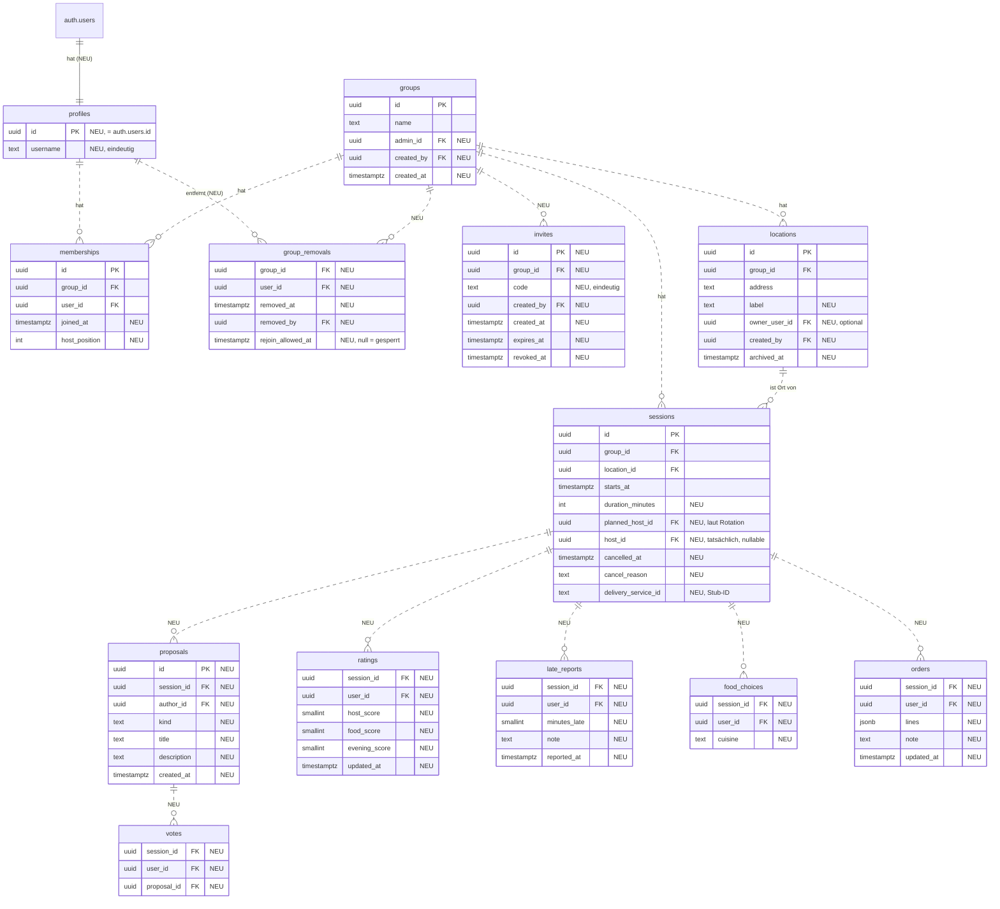

# Anforderungen des Controllers an das Model

Stand 05.11.2026. Von Maikel (Controller) an Mohammad (Model), zur Abstimmung.
Grundlage ist die [Controller-Schnittstelle](controller-schnittstelle.md). Verglichen mit dem
Schema aus PR #3 ([Datenmodell](datenmodell.md)).

Das sind **Anforderungen, keine fertigen Migrationen**. Namen, Tabellenschnitt und ob etwas als
Spalte, Tabelle oder Datenbankfunktion umgesetzt wird, entscheidet Mohammad. Wichtig ist, dass
der Controller die beschriebenen Daten lesen und die Änderungen auslösen kann.

## Was es schon gibt

| Vorhanden                                                                   | Reicht für                                |
| --------------------------------------------------------------------------- | ----------------------------------------- |
| `groups (id, name)`                                                         | Gruppen anzeigen                          |
| `memberships (id, group_id, user_id)`, eindeutig je Gruppe                  | Mitgliedschaft prüfen                     |
| `locations (id, group_id, address)`                                         | Adresse eines Termins                     |
| `sessions (id, group_id, location_id, starts_at)`, Ort aus derselben Gruppe | nächster Termin (Story 1), Statistik (E2) |
| RLS: Mitglieder lesen ihre Gruppen, Orte, Termine                           | Lesen in Story 1                          |
| `signIn`, `getGroupsForUser`, `getSessionsForGroup`                         | Story 1                                   |

Alles andere fehlt. Aus der App heraus kann bisher nichts geschrieben werden.

## Zielbild

Neue Tabellen und Spalten sind mit "NEU" markiert.

## Fehlende Daten je Bereich

### Konto

| Bedarf                                                                           | Wofür                             | Hinweis                                                                                               |
| -------------------------------------------------------------------------------- | --------------------------------- | ----------------------------------------------------------------------------------------------------- |
| Tabelle `profiles` mit `username`, eindeutig ohne Groß-/Kleinschreibung          | Registrierung, Anzeigename        | z. B. eindeutiger Index auf `lower(username)`                                                         |
| Registrierung mit Benutzername, E-Mail, Passwort                                 | `signUp`                          | Profil im selben Schritt anlegen, z. B. per Trigger auf `auth.users` mit `username` aus den Metadaten |
| Prüfen, ob ein Benutzername frei ist                                             | Fehler `username-taken`           | Fehler der Eindeutigkeit reicht, wenn er erkennbar ist                                                |
| Abmelden, aktuelle Anmeldung abfragen, Änderungen beobachten                     | `useAuth` (`checking`, `signOut`) | Supabase `signOut`, `getSession`, `onAuthStateChange` über das Model                                  |
| Mitglieder anderer lesen dürfen: `username` von Personen aus gemeinsamen Gruppen | Mitgliederliste, Gastgeber:in     | RLS auf `profiles`                                                                                    |
| Supabase: Mindestlänge Passwort 8                                                | `weak-password`                   | Einstellung im Projekt                                                                                |

### Gruppen, Leitung, Mitglieder

| Bedarf                                                                                                                                                                                                                           | Wofür                                            |
| -------------------------------------------------------------------------------------------------------------------------------------------------------------------------------------------------------------------------------- | ------------------------------------------------ |
| `groups.admin_id`, `groups.created_by`, `created_at`                                                                                                                                                                             | Gruppenleitung, anfangs Gründer:in               |
| `memberships.joined_at` (Standard `now()`)                                                                                                                                                                                       | Nachfolge der Leitung, Sortierung                |
| Gruppe anlegen: Gruppe, Mitgliedschaft und Leitung in einem Schritt                                                                                                                                                              | `createGroup`                                    |
| Gruppe umbenennen, nur Leitung                                                                                                                                                                                                   | `renameGroup`                                    |
| Gruppe verlassen in einem Schritt: Mitgliedschaft löschen, bei Leitung Nachfolge setzen (frühestes `joined_at`, dann kleinste `user_id`), bei letztem Mitglied Gruppe löschen, `host_id` kommender Termine der Person auf `null` | `leaveGroup`                                     |
| Mitglied entfernen, nur Leitung: Mitgliedschaft löschen, Eintrag in `group_removals`, `host_id` kommender Termine auf `null`                                                                                                     | `removeMember`                                   |
| Beitritt freigeben, nur Leitung: `rejoin_allowed_at` setzen                                                                                                                                                                      | `allowRejoin`                                    |
| Lesen von `group_removals` nur für die Leitung                                                                                                                                                                                   | `GroupDetails.removedUsers`                      |
| Löschen einer Gruppe entfernt abhängige Daten                                                                                                                                                                                    | letztes Mitglied tritt aus (`on delete cascade`) |

Austritt und Entfernen sollten jeweils **ein** Datenbankschritt sein (z. B. eine Funktion, die
per RPC aufgerufen wird), damit eine Gruppe nie ohne Leitung zurückbleibt.

### Einladungen

| Bedarf                                                                                                                                   | Wofür               |
| ---------------------------------------------------------------------------------------------------------------------------------------- | ------------------- |
| Tabelle `invites` mit Code, Ablauf (7 Tage), Widerruf                                                                                    | Einladungscode      |
| Code serverseitig erzeugen: 8 Zeichen aus `ABCDEFGHJKMNPQRSTUVWXYZ23456789`, zufällig, eindeutig                                         | `getOrCreateInvite` |
| Gültigen Code holen oder neuen anlegen, jedes Mitglied                                                                                   | `getOrCreateInvite` |
| Alten Code widerrufen und neuen anlegen, nur Leitung                                                                                     | `renewInvite`       |
| Vorschau ohne Mitgliedschaft: Gruppenname, Mitgliederzahl, Ablauf                                                                        | `previewInvite`     |
| Beitreten per Code mit allen Prüfungen aus dem Ablaufdiagramm, Ergebnis unterscheidbar (unbekannt, abgelaufen, gesperrt, schon Mitglied) | `joinGroup`         |
| Neues Mitglied ans Ende der Rotation (`host_position`)                                                                                   | `joinGroup`         |

Vorschau und Beitritt brauchen Zugriff auf eine Gruppe, in der die Person noch nicht Mitglied
ist. Das geht mit RLS nur über eine Datenbankfunktion, die gezielt diese Prüfungen macht. Die
Sperre entfernter Personen muss dort geprüft werden, nicht nur im Controller.

### Orte

| Bedarf                                                          | Wofür                               |
| --------------------------------------------------------------- | ----------------------------------- |
| `locations.label`, `owner_user_id`, `created_by`, `archived_at` | Orte unabhängig vom Termin          |
| Anlegen durch jedes Mitglied                                    | `createLocation`                    |
| Ändern und Archivieren nur durch die Leitung                    | `updateLocation`, `archiveLocation` |
| Kein Löschen, wenn Termine den Ort nutzen                       | Statistik bleibt korrekt            |

### Termine und Kalender

| Bedarf                                                                                           | Wofür                                             |
| ------------------------------------------------------------------------------------------------ | ------------------------------------------------- |
| `sessions.duration_minutes` (30 bis 1440)                                                        | Endzeit, Überschneidung (E1), Zeitfenster         |
| `sessions.cancelled_at`, `cancel_reason`                                                         | Absagen ohne Löschen                              |
| Anlegen, Ändern, Absagen nur durch die Leitung                                                   | `createSession`, `updateSession`, `cancelSession` |
| Termine in einem Zeitraum über alle eigenen Gruppen lesen, mit Ort, Gruppenname und Gastgeber:in | `useCalendar`, E1                                 |
| Index auf `sessions (group_id, starts_at)`                                                       | Kalender und Übersicht                            |

**Keine Datenbankregel gegen Überschneidungen** (z. B. kein Exclusion Constraint).
Gleichzeitige Termine einer Person sind ausdrücklich erlaubt, der Controller warnt nur
(Entscheidung E-009).

### Gastgeber-Rotation

| Bedarf                                                            | Wofür                       |
| ----------------------------------------------------------------- | --------------------------- |
| `memberships.host_position`                                       | feste Reihenfolge           |
| Reihenfolge in einem Schritt setzen, nur Leitung                  | `reorderHosts`              |
| `sessions.planned_host_id` (laut Rotation, bleibt fest)           | Rotation läuft fair weiter  |
| `sessions.host_id` (tatsächlich, kann `null` sein)                | Anzeige, Vertretung, Tausch |
| Vertretung: `host_id` ändern, Leitung oder bisherige Gastgeber:in | `setSessionHost`            |
| Tausch: `host_id` zweier Termine in einem Schritt tauschen        | `swapSessionHosts`          |

### Vorschläge und Abstimmung (Story 3, 4)

| Bedarf                                                                                  | Wofür                 |
| --------------------------------------------------------------------------------------- | --------------------- |
| Tabelle `proposals`, `kind` in `one-shot`, `module`, `campaign-focus`                   | `propose`             |
| Löschen durch Autor:in oder Leitung, Stimmen werden mitgelöscht                         | `deleteProposal`      |
| Tabelle `votes`, **eindeutig je `(session_id, user_id)`**                               | eine Stimme je Person |
| Stimme setzen oder verschieben in einem Schritt (Upsert)                                | `vote`                |
| Stimmenzahl je Vorschlag lesbar, aber nicht wer wie gestimmt hat (außer eigener Stimme) | Anonymität            |

### Bewertung (Story 5)

| Bedarf                                                                                                         | Wofür                 |
| -------------------------------------------------------------------------------------------------------------- | --------------------- |
| Tabelle `ratings`, eindeutig je `(session_id, user_id)`, Werte 1 bis 5, `host_score` und `food_score` optional | `rateSession`         |
| Durchschnitte und Anzahl lesbar, Einzelwerte nur die eigenen                                                   | Anonymität            |
| Gastgeber:in darf `host_score` nicht setzen                                                                    | keine Selbstbewertung |

### Verspätung (Story 6)

| Bedarf                                                                          | Wofür                         |
| ------------------------------------------------------------------------------- | ----------------------------- |
| Tabelle `late_reports`, eindeutig je `(session_id, user_id)`, 5 bis 240 Minuten | `reportLate`                  |
| Für alle Mitglieder lesbar, nur eigene änderbar                                 | Anzeige, `withdrawLateReport` |

### Essen (Story 7 bis 9)

| Bedarf                                                                                              | Wofür                   |
| --------------------------------------------------------------------------------------------------- | ----------------------- |
| Tabelle `food_choices`, eindeutig je `(session_id, user_id)`                                        | `chooseCuisine`         |
| `sessions.delivery_service_id` (ID aus dem Controller-Stub), setzen durch Gastgeber:in oder Leitung | `chooseDeliveryService` |
| Tabelle `orders`, eindeutig je `(session_id, user_id)`, Positionen als JSON                         | `submitOrder`           |
| Eigene Bestellung lesbar, alle Bestellungen nur für die Gastgeber:in                                | `useOrders`             |

Lieferdienste und Menüs selbst brauchen keine Tabellen, sie sind Beispieldaten im Controller.

## Schreibrechte (RLS) im Überblick

| Aktion                                                                   | Wer                                          |
| ------------------------------------------------------------------------ | -------------------------------------------- |
| Gruppe anlegen                                                           | jede angemeldete Person                      |
| Gruppe umbenennen, Mitglied entfernen, Beitritt freigeben, Code erneuern | Leitung                                      |
| Code holen bzw. anlegen                                                  | Mitglied                                     |
| Ort anlegen                                                              | Mitglied                                     |
| Ort ändern, archivieren                                                  | Leitung                                      |
| Termin anlegen, ändern, absagen                                          | Leitung                                      |
| Reihenfolge der Gastgeber:innen                                          | Leitung                                      |
| Vertretung                                                               | Leitung oder aktuelle Gastgeber:in           |
| Tausch                                                                   | Leitung oder eine der beiden Gastgeber:innen |
| Vorschlag anlegen                                                        | Mitglied                                     |
| Vorschlag löschen                                                        | Autor:in oder Leitung                        |
| Stimme, Bewertung, Verspätung, Essenswahl, Bestellung                    | Mitglied, nur eigener Datensatz              |
| Lieferdienst wählen                                                      | Gastgeber:in oder Leitung                    |

## Zeitfenster

Die Zeitfenster (Abstimmung, Essenswahl, Bestellung, Verspätung, Bewertung) prüft der
Controller. Ohne Prüfung in der Datenbank könnte jemand mit eigenem Client außerhalb der
Fenster schreiben. Für das Uni-Projekt reicht aus Controller-Sicht die Prüfung im Controller.
Mohammad entscheidet, ob er sie zusätzlich in RLS oder Datenbankfunktionen abbildet. Die Werte
stehen in der Controller-Schnittstelle unter "Ablauf eines Termins".

## Model-Funktionen, die der Controller aufrufen möchte

Vorschlag für die öffentliche API in `src/model/index.ts`. Namen sind verhandelbar, wichtig sind
Eingaben und Ergebnis. Fehler sollten so geworfen werden, dass der Controller sie unterscheiden
kann (z. B. Supabase-Fehlercode oder eigene Fehlerklasse mit Code).

| Bereich       | Funktionen                                                                                                                                       |
| ------------- | ------------------------------------------------------------------------------------------------------------------------------------------------ |
| Konto         | `signUp`, `signIn` (vorhanden), `signOut`, `getCurrentUser`, `onAuthChange`                                                                      |
| Gruppen       | `getGroupsForUser` (vorhanden), `getGroupMembers`, `getGroupRemovals`, `createGroup`, `renameGroup`, `leaveGroup`, `removeMember`, `allowRejoin` |
| Einladungen   | `getActiveInvite`, `getOrCreateInvite`, `renewInvite`, `previewInvite`, `joinGroupByCode`                                                        |
| Orte          | `getLocations`, `createLocation`, `updateLocation`, `archiveLocation`                                                                            |
| Termine       | `getSessionsForGroup` (vorhanden), `getSessionsForUser(from, to)`, `getSession`, `createSession`, `updateSession`, `cancelSession`               |
| Rotation      | `setHostOrder`, `setSessionHost`, `swapSessionHosts`                                                                                             |
| Story 3, 4    | `getProposals`, `createProposal`, `deleteProposal`, `setVote`, `deleteVote`                                                                      |
| Story 5       | `getRatingSummary`, `getMyRating`, `upsertRating`                                                                                                |
| Story 6       | `getLateReports`, `upsertLateReport`, `deleteLateReport`                                                                                         |
| Story 7 bis 9 | `getFoodChoices`, `upsertFoodChoice`, `deleteFoodChoice`, `setDeliveryService`, `getOrders`, `upsertOrder`, `deleteOrder`                        |

## Reihenfolge-Vorschlag

1. Konto (`profiles`, `signUp`, `signOut`) und Gruppen mit Leitung, weil alles darauf aufbaut.
2. Einladungen, damit das Team echte Gruppen bilden kann.
3. Orte, Termine mit Dauer und Absage, Rotation.
4. Stories 3 bis 6.
5. Stories 7 bis 9 (optional).

## Anmerkungen aus Maikels Durchsicht von PR #3

- Fremdschlüssel ohne Löschverhalten: Löschen eines Kontos oder einer Gruppe schlägt fehl.
- Fehlende Indizes auf `memberships (user_id)` und `sessions (group_id, starts_at)`.
- In RLS-Policies `(select auth.uid())` statt `auth.uid()` (Empfehlung von Supabase).
